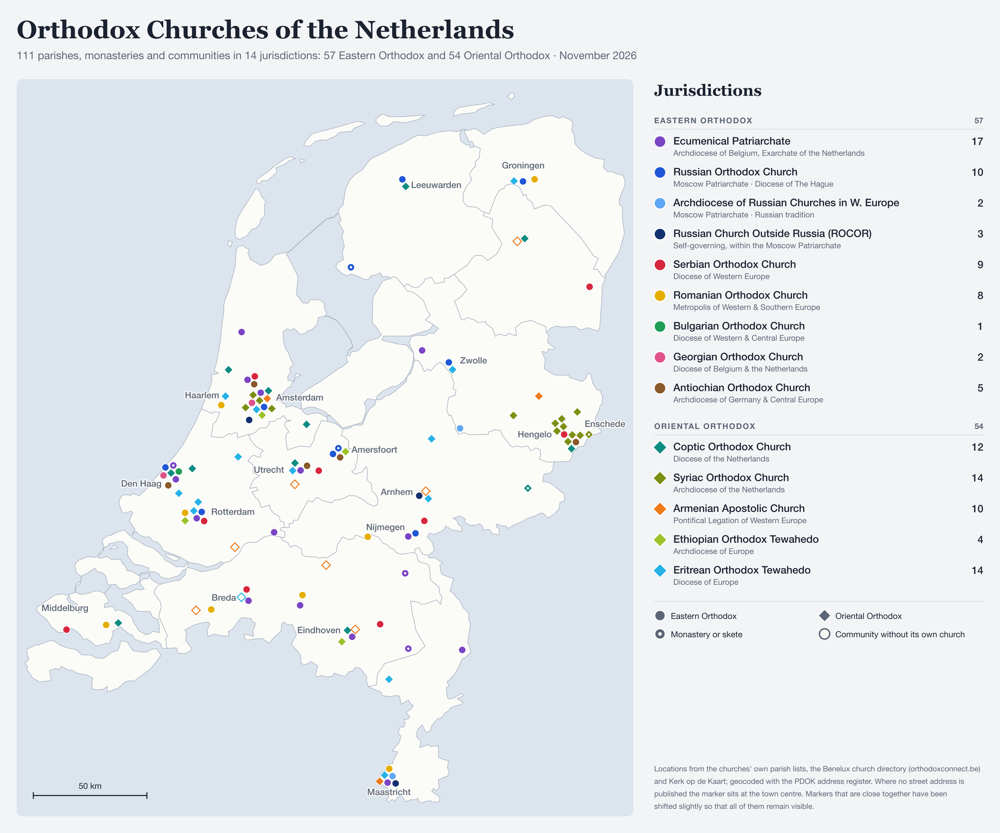
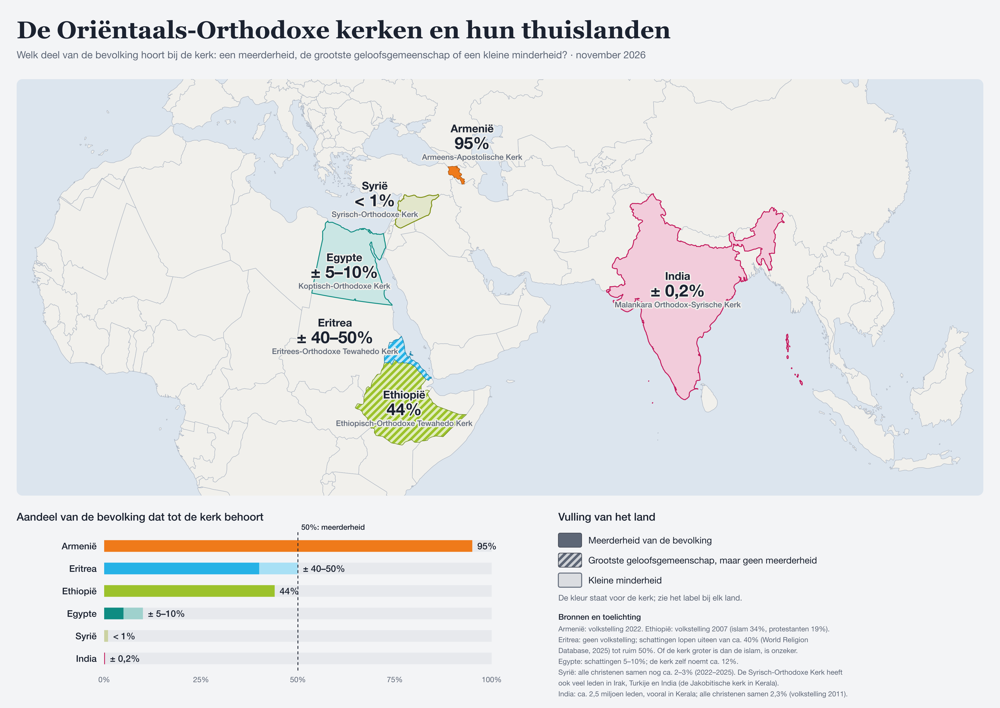

# Orthodox Churches of the Netherlands

A map of every Eastern Orthodox and Oriental Orthodox parish, monastery and community in the Netherlands, colour-coded by jurisdiction, with a legend.



- **Output:** the same map in English and Dutch, each as one file containing the map and the legend:

  | | For screens (PNG, 3600 × 3000 px) | For print (vector PDF, 1200 × 1000 mm) |
  |---|---|---|
  | English | [`orthodox-churches-en.png`](orthodox-churches-en.png) | [`orthodox-churches-en.pdf`](orthodox-churches-en.pdf) |
  | Dutch | [`orthodox-churches-nl.png`](orthodox-churches-nl.png) | [`orthodox-churches-nl.pdf`](orthodox-churches-nl.pdf) |

  For printing, use the PDF; see [Printing](#printing).
- **Current data:** 111 entries in 14 jurisdictions: 57 Eastern Orthodox and 54 Oriental Orthodox, including 7 monasteries and 8 communities without their own church building.

Where several churches are close together (Amsterdam, Den Haag, Twente, Maastricht), markers are nudged apart just enough to all stay visible. The shifts are small (a few hundred metres at most), and the footnote on the map says so. Town names are placed automatically next to their town, on whichever side is free of markers.

---

## Quick start

```sh
python3 build.py              # validate data, geocode new addresses, draw both maps (PNG + PDF)
open orthodox-churches-en.png  # the finished map in English
open orthodox-churches-nl.pdf  # the Dutch poster PDF
```

Requirements:
- **Python 3.8+**, standard library only.
- **`rsvg-convert`** from librsvg, which turns the drawing into PNG and PDF. Install it with `brew install librsvg` (Homebrew), `sudo port install librsvg` (MacPorts) or `sudo apt install librsvg2-bin` (Debian/Ubuntu).

The fonts are Georgia (title) and Helvetica Neue (text); other systems fall back to Times and Arial.

| Command | What it does |
|---|---|
| `python3 build.py` | Validates the data, geocodes new or changed addresses, writes the PNG and PDF of both languages |
| `python3 build.py --lang nl` | Builds only one language (`en` or `nl`) |
| `python3 build.py --check` | Validates and geocodes, but writes no map |
| `python3 build.py --bleed 5` | Adds 5 mm bleed around the PDF page (see [Printing](#printing)) |
| `python3 build.py --poster-width 1500` | Makes the PDF page 1500 mm wide (height follows: 1250 mm) |
| `python3 build.py --no-pdf` | Writes only the PNGs |
| `python3 build.py --offline` | Uses only cached coordinates; fails if an address is new |
| `python3 build.py --refresh` | Geocodes every address again (for example after the address register changes) |
| `python3 build.py --svg DIR` | Also saves each drawing as an SVG (a vector version of the same image) in that folder |

The build stops, writes nothing, and names the CSV line when something is wrong. Problems it catches:
- an unknown jurisdiction or kind
- a malformed postcode
- an address the register can't find
- an address the geocoder placed in a **different postcode or town** than the one you wrote. For example, without a postcode "Bakkerstraat 57, Den Haag" resolves to Hilversum.

### Repository layout

```
build.py                  build script: validation, geocoding, writing the images
render.py                 draws the map and legend (layout, colours, sizes, label placement)
data/churches.csv         the churches: edit this file to add or change entries
data/jurisdictions.csv    jurisdictions with their legend colour, names and descriptions in English and Dutch
data/geocode-cache.json   cached coordinates (generated; keep it in the repo)
data/provinces.geojson    province outlines for the base map (CBS 2023 via cartomap)
orthodox-churches-en.png  OUTPUT: map and legend in English, for screens (generated; do not edit)
orthodox-churches-en.pdf  OUTPUT: the same as a vector poster PDF, 1200 x 1000 mm (generated)
orthodox-churches-nl.png  OUTPUT: map and legend in Dutch, for screens (generated; do not edit)
orthodox-churches-nl.pdf  OUTPUT: the same as a vector poster PDF, 1200 x 1000 mm (generated)

build_oriental.py         builds the second map: the Oriental Orthodox home countries (Dutch)
data/oriental-orthodox.csv       one row per country: church, colour, share, category, label position
data/countries-region.geojson    country outlines (Natural Earth 1:50m), clipped to the region
oriental-orthodox-nl.png  OUTPUT: home-countries map, 3600 x 2550 px (generated)
oriental-orthodox-nl.pdf  OUTPUT: the same as a vector PDF, 1200 x 850 mm (generated)
oriental-orthodox-nl-kaart.png  OUTPUT: only the map part with a small legend, 3840 x 1656 px, for screens (generated)
```

---

## Editing the data

All church data lives in **`data/churches.csv`**, one row per church. You can edit it in any text editor or spreadsheet program (save as CSV, UTF-8, comma-separated). After editing, run `python3 build.py`.

### Columns

| Column | Required | Meaning |
|---|---|---|
| `jurisdiction` | yes | Key from `data/jurisdictions.csv`: `ep`, `mp`, `aer`, `rocor`, `srb`, `rou`, `bul`, `geo`, `ant`, `copt`, `syr`, `arm`, `eth`, `eri` |
| `name` | yes | Name of the parish, monastery or community, in English |
| `kind` | yes | `parish`, `monastery` (drawn with a dot in the middle) or `community` (services but no church building, drawn hollow) |
| `building` | no | Building name shown before the address, e.g. `Byzantine Chapel` |
| `street` | no | Street and house number, e.g. `Barkstraat 5`. Leave empty if unknown: the marker is then placed near the town centre and marked as approximate. |
| `postcode` | recommended | e.g. `9745 BT`. Strongly recommended with a street; the build uses it to check the geocoder found the right address. |
| `place` | yes | Town as shown on the map, e.g. `Groningen`. `Den Haag` is fine. |
| `note` | no | Short remark for the record (not drawn on the image) |
| `lat`, `lon` | no | Manual coordinates, e.g. `51.83032` and `5.84744`. Fill these in only when the address register can't find the address (for example house number 21 doesn't exist as a registered address). They override geocoding. |
| `source` | recommended | Link to where the information comes from (not drawn on the image) |

### Add a church

Add a row at the bottom (or anywhere; the order doesn't matter):

```csv
eri,Debre Menkrat St Abune Gebre Menfes Kidus Church,parish,,Barkstraat 5,9745 BT,Groningen,In Hoogkerk,,,https://www.gebremenfeskdus.nl/
```

If you only know the town:

```csv
eri,Abune Aregawi Church,parish,,,,Apeldoorn,,,,https://eritresekerk.nl/
```

Then run `python3 build.py`. The new address is looked up once in the [PDOK Locatieserver](https://www.pdok.nl/introductie/-/article/pdok-locatieserver-1) (the Dutch government address register, no API key needed) and saved to `data/geocode-cache.json`.

### Change a church

Edit the row in place. If you change the street or postcode, the new address is geocoded automatically on the next build. To move a church to another jurisdiction, change its `jurisdiction` key.

### Remove a church

Delete the row.

### Add or change a jurisdiction

Edit `data/jurisdictions.csv`. Each row has a short `key` (used in `churches.csv`), a `family` (`Eastern` or `Oriental`, which decides circle or diamond markers), a `color` (`#rrggbb`), and a name and subtitle in each language (`name_en`, `subtitle_en`, `name_nl`, `subtitle_nl`). The names and subtitles are printed in the legend of the matching image. The order of rows is the order in the legend. The legend grows with the number of jurisdictions; with more than about 16, enlarge `H` in `render.py`.

### Printing

Use the **PDF** for printing. Everything on the map (coastline, markers, text) is vector, so the PDF stays sharp at any size and is only about 150 KB. The page is 1200 × 1000 mm (landscape), and the fonts are embedded.

At that size the smallest text (legend descriptions, footnote) is about 9 mm high and the markers about 8.5 mm across: readable from 2 to 3 metres.

**For a different size**, keep the 6 : 5 proportions and use `--poster-width`. For example, `--poster-width 600` gives an A1-like 600 × 500 mm.

**If you need a bitmap** instead, the PNG at 3600 × 3000 px is only about 76 dpi at poster size, which is fine for screens but blurry in print. At 1200 × 1000 mm you need about 7100 × 5900 px (150 dpi) for viewing from a metre or more, or 14200 × 11800 px (300 dpi) for close viewing. Set `S` in `render.py` to 3 or 6 respectively; markers, text and spacing scale along, so the picture stays the same.

**Points to raise with the print shop:**
- **Bleed.** For edge-to-edge printing most shops want 3–5 mm extra background on every side. `python3 build.py --bleed 5` adds this: the page grows to 1210 × 1010 mm and the grey background runs into the extra margin, while the map stays in place on the trimmed page. Without bleed, ask for printing with a white border instead.
- **Colour.** The colours are defined for screens (RGB). The printer converts them to CMYK, which can make the brightest colours (sky blue, lime, pink) a little duller. Ask for a proof if exact colours matter.
- **Fonts.** The fonts are embedded. A few characters are embedded as Type 3 fonts, which nearly all print software accepts. If the shop's software complains anyway, tell them that's the cause.

### Change the look of the image

All drawing settings are at the top of `render.py`:
- `S`: overall resolution. 1.5 gives 3600 × 3000 px; 2.0 gives 4800 × 4000 px.
- `R`: marker radius. Smaller markers give dense clusters more room.
- Colours and fonts.
- `TOWN_LABELS`: which towns are named on the map.
- `TEXT`: the title, subtitle, legend headings, symbol key and footnote in each language.

The month in the subtitle is the date `data/churches.csv` was last changed, written in the image's language.

To add a language (say German):
1. Add a `"de"` entry to `TEXT` in `render.py`.
2. Add `"de"` to `OUTPUTS` and `MONTHS` in `build.py`.
3. Add `name_de` and `subtitle_de` columns to `data/jurisdictions.csv`.

The build always draws the same image from the same data, so changes are easy to compare.

---

## Legend

Eastern Orthodox churches are circles, Oriental Orthodox churches are diamonds.

| Colour | Jurisdiction | On the map (Dutch) | Structure in the Netherlands | Entries |
|---|---|---|---|---|
| purple `#7a45c4` | Ecumenical Patriarchate | Oecumenisch Patriarchaat | Archdiocese of Belgium, Exarchate of the Netherlands | 17 |
| blue `#1f57d6` | Russian Orthodox Church | Russisch-Orthodoxe Kerk | Moscow Patriarchate · Diocese of The Hague | 10 |
| light blue `#5ea7f5` | Archdiocese of Russian Churches in W. Europe | Aartsbisdom Russische Kerken in West-Europa | Moscow Patriarchate · Russian tradition | 2 |
| navy `#13306e` | Russian Church Outside Russia (ROCOR) | Russisch-Orthodoxe Kerk in het Buitenland | Self-governing, within the Moscow Patriarchate | 3 |
| red `#d7263d` | Serbian Orthodox Church | Servisch-Orthodoxe Kerk | Diocese of Western Europe | 9 |
| gold `#e6ad00` | Romanian Orthodox Church | Roemeens-Orthodoxe Kerk | Metropolis of Western & Southern Europe | 8 |
| green `#1f9d55` | Bulgarian Orthodox Church | Bulgaars-Orthodoxe Kerk | Diocese of Western & Central Europe | 1 |
| pink `#e0528a` | Georgian Orthodox Church | Georgisch-Orthodoxe Kerk | Diocese of Belgium & the Netherlands | 2 |
| brown `#8a5a2b` | Antiochian Orthodox Church | Antiocheens-Orthodoxe Kerk | Archdiocese of Germany & Central Europe | 5 |
| teal `#0f8c82` | Coptic Orthodox Church | Koptisch-Orthodoxe Kerk | Diocese of the Netherlands | 12 |
| olive `#7d8f14` | Syriac Orthodox Church | Syrisch-Orthodoxe Kerk | Archdiocese of the Netherlands | 14 |
| orange `#ef7a1a` | Armenian Apostolic Church | Armeens-Apostolische Kerk | Pontifical Legation of Western Europe | 10 |
| lime `#9cc22b` | Ethiopian Orthodox Tewahedo | Ethiopisch-Orthodoxe Tewahedo Kerk | Archdiocese of Europe | 4 |
| sky blue `#26b2e6` | Eritrean Orthodox Tewahedo | Eritrees-Orthodoxe Tewahedo Kerk | Diocese of Europe | 14 |

The three Russian structures all fall under the Moscow Patriarchate and therefore share a blue colour family.

---

## About the data

Compiled in November 2026.

### Placement

- **Exact addresses.** Most Eastern Orthodox entries and most Oriental Orthodox entries have an exact address, geocoded with the PDOK address register.
- **Town only.** 20 entries are placed near the town centre because no address was published. Mostly these are Coptic parishes, Armenian communities, and a few Eritrean ones. They are the rows in `data/churches.csv` with an empty `street`.
- **Shared buildings and clusters.** Markers that would overlap are pushed apart just enough to all be visible. Examples are parishes sharing a building, such as the Byzantine Chapel in Nijmegen (Greek and Russian), Bakkersstraat 57a in Den Haag (Bulgarian and Georgian) and Stationsstraat 13 in Zaandam (Serbian and Antiochian), and several town-only entries in one town. The shifts average about one marker width, so no lines are drawn back to the true location; the footnote on the map mentions the shift instead.

### Known uncertainties

- **Georgian, Exaltation of the Cross.** OKiN gives Louis Bouwmeesterstraat 74, Amsterdam; the Benelux directory lists a parish of that name under Aalsmeer. The Amsterdam address is used.
- **Romanian, St John Chrysostom.** OKiN lists Oosteinderweg 394, Aalsmeer; the newer Benelux directory gives Valkenburgerplein 20, Heemstede. Heemstede is used.
- **Moscow Patriarchate, Amsterdam St Nicholas.** This parish moved to the Ecumenical Patriarchate in 2022 and is shown under the Ecumenical Patriarchate.
- **Eritrean, Rotterdam.** Two churches are listed separately (Larikslaan 182 and Adrien Mildersstraat 47A). They may be separate congregations or the same community.
- **Eritrean, Arnhem.** The Bethaniënstraat 1 address is the parish's registered address and may not be where services are held.
- **Eritrean, Maastricht.** The community received the keys of the Koepelkerk (Sacred Heart church) in 2021, so this may be out of date. It is placed by town.
- **Eritrean, Utrecht.** Services in the Majellakerk are known only from an undated source. It is placed by town.
- **Eritrean, Breda.** The community has no building of its own and is hosted by various churches, so it is shown as a community.
- **Syriac, Mor Matta.** Sources give different addresses (Duivendrecht; Granpré Molièreplein 2, Amsterdam; Vossiuslaan 2, Leiderdorp). It is placed in Duivendrecht by town.
- **Syriac, other parishes.** The Syriac archdiocese's own website (morephrem.com) was down when this was compiled, so a recently founded Syriac parish could be missing.
- **Ethiopian, Veldhoven.** The Ethiopian site gives postcode 5044 HH, but the address register has Dorpstraat 18 under 5504 HH. The register's postcode is used.
- **Not included.** The Malankara (Indian) Orthodox Church is left out: no Dutch parish could be confirmed.

### Why the Eritrean list was initially incomplete

The first version of the map had only 3 Eritrean churches, and the Hoogkerk church near Groningen was missing.
- **No central list.** The Eastern Orthodox jurisdictions publish official parish lists that could be cross-checked against the Benelux directory. The Eritrean Orthodox Church has no Dutch diocesan website or parish list.
- **Too few searches.** The first pass relied on one search and an older list of towns, and dropped towns it couldn't confirm.
- **Fix.** Each town was searched separately in parish websites, local news and the [Kerk op de Kaart](https://www.kerkopdekaart.nl/) directory, which has a category for Oriental Orthodox churches.
- **Result.** This found 14 Eritrean locations, matching the figure of 14 churches the community gave in 2023. The same check added a Coptic parish in Enschede, exact addresses for most Syriac churches, and corrected the Ethiopian locations (Veldhoven rather than Eindhoven; Amersfoort's current address).
- **Tip for adding a group without a central list.** Look for a stated total number of churches and compare your count against it. Kerk op de Kaart is a good place to check.

---

## Second map: the Oriental Orthodox home countries



A Dutch-language map of the six Oriental Orthodox churches and their home countries, built with `python3 build_oriental.py`. It writes three files; `--no-pdf` and `--svg DIR` work as for the main map.

- `oriental-orthodox-nl.png`: the full map with title, chart and legend.
- `oriental-orthodox-nl.pdf`: the same as a vector PDF for print.
- `oriental-orthodox-nl-kaart.png`: only the map part, labels included, without title and chart. A compact legend explaining the three fill styles sits in the Arabian Sea, so the image can stand on its own; its position is `INSET_LEGEND_AT` in `build_oriental.py`. It is 3840 px wide (4K) and meant for screens, slides and websites. It is drawn from the same vector drawing as the PDF, not cropped from a bitmap. To change its width, set `MAP_PNG_WIDTH` in `build_oriental.py`.

Each country is coloured by its church. The **fill style** shows how large the church is in that country:
- **Solid:** the church is followed by a majority of the population.
- **Hatched:** it is the largest religious community, but has no majority.
- **Light tint with outline:** it is a small minority.

A bar chart below the map compares the six shares against the 50% line.

| Country | Church | Share of population | Category | Basis |
|---|---|---|---|---|
| Armenia | Armenian Apostolic Church | 95% | majority | 2022 census |
| Ethiopia | Ethiopian Orthodox Tewahedo Church | 44% | largest, no majority | 2007 census (Islam 34%, Protestants 19%); no newer census |
| Eritrea | Eritrean Orthodox Tewahedo Church | about 40–50% | largest, no majority (uncertain) | No census. Estimates range from 39% (World Religion Database 2025) and about two-fifths (Britannica) to over 50% (CNEWA). Christians and Muslims are each roughly half, so whether the church outnumbers Islam is uncertain. |
| Egypt | Coptic Orthodox Church | about 5–10% | minority | Estimates range from about 5% (survey-based) to 10%; the church itself says about 12% |
| Syria | Syriac Orthodox Church | under 1% | minority | All Christians together were about 10% before 2011 and are about 2–3% now; the Syriac Orthodox Church is the second largest after the Greek Orthodox |
| India | Malankara Orthodox Syrian Church | about 0.2% | minority | About 2.5 million members, mostly in Kerala; all Christians 2.3% (2011 census) |

The Syriac Orthodox Church also has many members outside Syria: in Iraq, Turkey (Tur Abdin) and India, where the Jacobite Syrian Church in Kerala belongs to it.

**Editing:** change figures, labels or colours in `data/oriental-orthodox.csv`.
- `low` and `high` are the share in percent; for a single figure, make them equal.
- `share_text` is the text printed on the map.
- `category` is `meerderheid`, `grootste` or `minderheid`.
- `label_lon` and `label_lat` place the label. When a label sits outside its country, a line is drawn to the country automatically. Set `leader` to `no` to leave that line out. The labels for Syria, Eritrea and Armenia use `no`. Syria's and Eritrea's are placed so that only their bottom line (the church name) runs into the country; Armenia's sits just above it.

The map text (title, legend, footnote) is at the top of `build_oriental.py`.

Sources for the figures:
- [Religion in Armenia](https://en.wikipedia.org/wiki/Religion_in_Armenia) (2022 census)
- [Religion in Ethiopia](https://en.wikipedia.org/wiki/Religion_in_Ethiopia) (2007 census)
- Eritrea:
  - [Religion in Eritrea](https://en.wikipedia.org/wiki/Religion_in_Eritrea)
  - [Britannica: Eritrean Orthodox Tewahedo Church](https://www.britannica.com/topic/Eritrean-Orthodox-Tewahedo-Church)
  - [ARDA / World Religion Database: Eritrea](https://www.thearda.com/world-religion/national-profiles?u=76c)
  - [CNEWA: the Eritrean Orthodox Church](https://cnewa.org/eastern-christian-churches/oriental-orthodox-churches/the-eritrean-orthodox-church/)
- Egypt:
  - [Christianity in Egypt](https://en.wikipedia.org/wiki/Christianity_in_Egypt)
  - [Copts in Egypt](https://en.wikipedia.org/wiki/Copts_in_Egypt)
  - [Minority Rights Group: Copts](https://minorityrights.org/communities/copts/)
- Syria:
  - [Christianity in Syria](https://en.wikipedia.org/wiki/Christianity_in_Syria)
  - [ARDA / World Religion Database: Syria](https://www.thearda.com/world-religion/national-profiles?u=217c)
- [Oriental Orthodoxy by country](https://en.wikipedia.org/wiki/Oriental_Orthodoxy_by_country) (India and overview)
- [Natural Earth](https://www.naturalearthdata.com/) 1:50m country outlines (public domain)

---

## Sources

Each row in `data/churches.csv` links to its own source. The main sources:

### Directories covering several jurisdictions
- [OKiN, Orthodoxe Kerk in Nederland: parish lists per jurisdiction](https://orthodoxekerk.net/parochies/)
  - [Ecumenical Patriarchate](https://orthodoxekerk.net/parochies/oecumenisch-patriarchaat/)
  - [Patriarchate of Antioch](https://orthodoxekerk.net/parochies/patriarchaat-van-antiochie/)
  - [ROCOR](https://orthodoxekerk.net/parochies/russ-orth-kerk-in-het-buitenland/)
  - [Archdiocese of Russian tradition](https://orthodoxekerk.net/parochies/aartsbisdom-russische-traditie/)
  - [Serbian Orthodox Church](https://orthodoxekerk.net/parochies/servisch-orthodoxe-kerk/)
  - [Romanian Patriarchate](https://orthodoxekerk.net/parochies/patriarchaat-van-roemenie/)
  - [Bulgarian Patriarchate](https://orthodoxekerk.net/parochies/patriarchaat-van-bulgarije/)
  - [Georgian Patriarchate](https://orthodoxekerk.net/parochies/patriarchaat-van-georgie/)
- [Orthodox Benelux church directory (orthodoxconnect.be)](https://orthodoxconnect.be/kerken)
- [Kerk op de Kaart](https://www.kerkopdekaart.nl/)
- [Orthodox Basics: Orthodox churches in the Netherlands](https://www.orthodoxbasics.com/orthodoxe-kerken-in-nederland)
- [Platform Oosters Christendom](https://www.oosterschristendom.nl/)
- [Reformatorisch Dagblad: overview of the Orthodox churches in the Netherlands](https://www.rd.nl/artikel/968461-hoe-ziet-het-veelkleurige-geheel-van-de-orthodoxe-kerken-in-nederland-eruit)

### Eastern Orthodox
- [Russian Orthodox Diocese of The Hague and the Netherlands: list of parishes](https://russian-diocese.nl/parochies/lijst-van-parochies/)
- [Wikipedia: Diocese of The Hague and the Netherlands](https://en.wikipedia.org/wiki/Diocese_of_The_Hague_and_the_Netherlands)
- [Orthodox Exarchate of the Netherlands (Ecumenical Patriarchate): parishes](https://orthodoxexarchaat.org/3-parochies/)
- [Orthodox Archdiocese of Belgium: parishes](https://orthodoxia.be/nl/parochies/)
- [NOS: Amsterdam Russian Orthodox clergy leave the Moscow Patriarchate (2022)](https://nos.nl/collectie/13888/artikel/2420909-russisch-orthodoxe-geestelijken-in-amsterdam-verlaten-kerk-van-moskou)

### Coptic Orthodox
- [Coptic Orthodox Diocese of the Netherlands: churches](https://www.koptischekerk.nl/kerken/)
- [Wikipedia: Koptisch-Orthodox Bisdom van Nederland](https://nl.wikipedia.org/wiki/Koptisch-Orthodox_Bisdom_van_Nederland)
- Kerk op de Kaart:
  - [Amsterdam](https://www.kerkopdekaart.nl/Kerk/id=DF502B34-8724-4257-AD87-FC544CA81B63)
  - [Utrecht](https://www.kerkopdekaart.nl/Kerk/id=79D2378F-7D4F-469B-BE16-4F4E5B84C341)
  - [Bussum](https://www.kerkopdekaart.nl/Kerk/id=C5ABBD36-758D-48A8-9A78-A83B42006B5D)
  - [Enschede](https://www.kerkopdekaart.nl/Kerk/id=A3884457-CBE0-4D09-8FC6-5C7C7DD3E278)

### Syriac Orthodox
- [Wikipedia: Syrisch-Orthodox Aartsbisdom van Nederland](https://nl.wikipedia.org/wiki/Syrisch-Orthodox_Aartsbisdom_van_Nederland)
- [Mor Ephrem Monastery, Glane](https://syriacorthodoxresources.org/ChMon/GlaneDEphrem/index.html)
- [Mor Kuryakos, Enschede](https://morkuryakos.nl/)
- [Mor Yakub van Sarugh, Enschede](https://deenschedegids.nl/syrisch-orthodoxe-kerk-mor-yakub-van-sarugh/)
- [Mor Augin, Hengelo (Reliwiki)](https://reliwiki.nl/index.php/Hengelo,_Castorweg_2_-_Paus_Joannes)
- [Mor Gabriel, Badhoevedorp](https://www.mapquest.com/tm/stichting-mor-gabriel-kerk-523992333)
- [1Twente: Hengelo, first Syriac Orthodox church in Europe](https://www.1twente.nl/artikel/6131746/hengelo-kreeg-de-primeur-eerste-syrisch-orthodoxe-kerk-in-europa-viert-vijftigste-verjaardag)
- Kerk op de Kaart:
  - [Hengelo, Apostle John](https://www.kerkopdekaart.nl/Kerk/id=F5947C1B-ADF8-4D22-A07F-57E1EB903119)
  - [Hengelo, Mariakerk](https://www.kerkopdekaart.nl/Kerk/id=310268D3-2A72-40F4-99DC-D64749F41385)
  - [Enschede, Peter and Paul](https://www.kerkopdekaart.nl/Kerk/id=D78CFC9E-3C10-4DA3-A34E-CDBC12E1F2F4)
  - [Amsterdam, Mother of God](https://www.kerkopdekaart.nl/Kerk/id=BD0067AD-2B68-40F1-9816-FA63A6FA3D47)
  - [Amsterdam, Mor Sharbel](https://www.kerkopdekaart.nl/Kerk/id=0217F782-1909-4FD9-8CFE-89D65CF89630)
  - [Rijssen](https://www.kerkopdekaart.nl/Kerk/id=6B3829AC-F395-4DB1-AD28-A09FA1296F9C)
  - [Oldenzaal](https://www.kerkopdekaart.nl/Kerk/id=F2537869-3D8C-4761-8B51-5FD868422184)

### Armenian Apostolic
- [Armenian Apostolic Church, Pontifical Legation of Western Europe: Netherlands](https://www.armenian-church.eu/en/regioncategories/nitherlands-en/)
- [Armenian Apostolic Church, Almelo](https://www.armeensekerk.nl/)
- [Wikipedia: Armenian Apostolic Church, Amsterdam](https://nl.wikipedia.org/wiki/Armeens-Apostolische_Kerk_(Amsterdam))
- [Armenpress: St Karapet church, Maastricht](https://armenpress.am/en/article/864604)
- [Kerk op de Kaart: Arnhem](https://www.kerkopdekaart.nl/Kerk/id=2E220615-A659-4126-9EB3-0D41BC0FB6FB)

### Ethiopian Orthodox Tewahedo
- [Ethiopian Orthodox Tewahedo Churches in the Netherlands (tewahedo.nl)](https://www.tewahedo.nl/contact)
- [Platform Oosters Christendom: ten years of the Amersfoort church](https://www.oosterschristendom.nl/nederland/wij-zijn-er-trots-op-om-als-eerste-kerk-in-de-diaspora-epifanie-en-meskel-in-de-open-ruimte-te-vieren/)
- Kerk op de Kaart:
  - [Amersfoort](https://www.kerkopdekaart.nl/Kerk/id=A5CAA622-5233-414A-9F4C-6FE817FB1BF4)
  - [Veldhoven](https://www.kerkopdekaart.nl/Kerk/id=8DE24A33-7600-4AFB-BE92-AEBA3621B5B6)
  - [Pernis](https://www.kerkopdekaart.nl/Kerk/id=15D0C35C-979C-45D4-B021-502B5081B1F0)

### Eritrean Orthodox Tewahedo
- [Debre Menkrat St Abune Gebre Menfes Kidus, Hoogkerk (Groningen)](https://www.gebremenfeskdus.nl/)
- [Debre Selam Medhanie Alem, Amsterdam](https://www.debreselammedhanealemkerkamsterdam.nl/)
- [Debre Selam Medhanie Alem, Amstelveen-Amstelland](https://www.debreselam-medhaniealem.com/nederland-1)
- [Debre Hayl Kidus Michael, Aarlanderveen (Leiden)](https://www.debrehaylqdusmichaelleiden.nl/)
- [Abune Aregawi, Apeldoorn](https://eritresekerk.nl/)
- [Gebiedsgids: Eritrean Orthodox church in the former St Paul's church, Rotterdam](https://www.gebiedsgids.nl/node/98585)
- [Weert de Gekste: Fatima Huis hosts the Eritrean church (2023; "14 churches")](https://www.weertdegekste.nl/2023/03/fatima-huis-biedt-onderdak-aan-eritrese-kerk/)
- [Weert de Gekste: meet the Eritrean Orthodox church (2024)](https://www.weertdegekste.nl/2024/07/maak-kennis-met-de-eritrees-orthodoxe-tewahedo-kerk/)
- [1Zuid: Eritrean community in the Koepelkerk, Maastricht](https://1zuid.nl/nieuws/artikel/eritrese-geloofsgemeenschap-in-koepelkerk)
- [Bisdom Breda: the Eritrean community in Breda](https://bisdombreda.nl/algemeen/een-inspirerende-ervaring-met-de-eritrese-gemeenschap-in-het-bisdom-breda/)
- [Jons Jeronimus: Eritrean service in the Majellakerk, Utrecht](https://jons.info/Tewahedo-Kerk)
- [Oozo: St Gabriel, Arnhem](https://www.oozo.nl/bedrijven/arnhem/presikhaaf-west/presikhaaf-iii/2541213/eritrese-orthodoxe-tewahdo-kerk-saint-gabril)
- Kerk op de Kaart:
  - [Delft](https://www.kerkopdekaart.nl/Kerk/id=B834E460-E181-458A-86A8-8B06B73E4D75)
  - [Haarlem](https://www.kerkopdekaart.nl/Kerk/id=5C4681A9-570D-4C95-BBC8-F79AE517780B)
  - [Zwolle](https://www.kerkopdekaart.nl/Kerk/id=31D3ADA1-0823-4122-AACC-738E0F93DE42)
  - [Rotterdam Kidane Mehret](https://www.kerkopdekaart.nl/Kerk/id=14BBD515-79A4-4313-ABE2-5720092A887E)
  - [Amstelveen-Amstelland](https://www.kerkopdekaart.nl/Kerk/id=7D10DF3E-FEE7-47F1-ADA1-0B005CEAE5D1)

### Map data and tools
- [PDOK Locatieserver](https://www.pdok.nl/introductie/-/article/pdok-locatieserver-1): geocoding of Dutch addresses
- [cartomap/nl](https://github.com/cartomap/nl): province outlines (CBS, 2023, WGS84)
- [librsvg](https://gitlab.gnome.org/GNOME/librsvg) (`rsvg-convert`): converts the drawing to PNG
